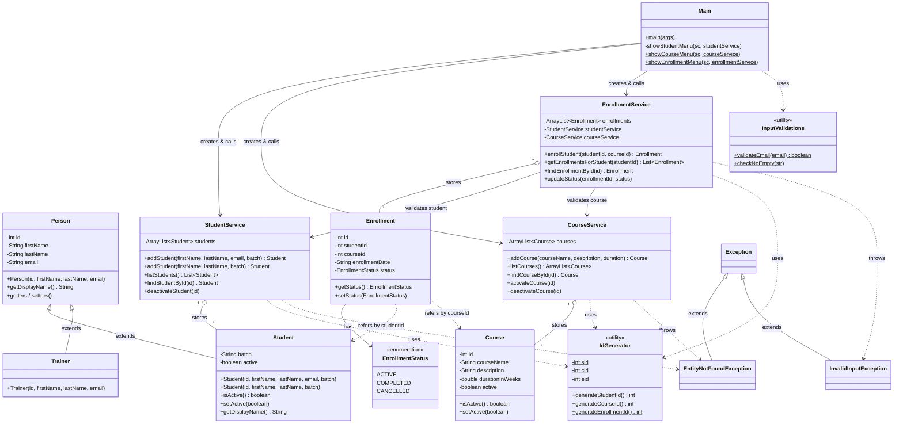

# LearnTrack – Student & Course Management System

## Project Description

LearnTrack is a menu-driven, console-based Java application for managing students, courses and enrollments of a training institute. All data is kept in memory (using `ArrayList`) for the duration of the program run.

### Features

**Student Management**
- Add a new student (email is optional)
- View all students
- Search a student by ID
- Deactivate a student (sets `active = false` instead of deleting)

**Course Management**
- Add a new course
- View all courses
- Activate / Deactivate a course

**Enrollment Management**
- Enroll a student in a course
- View enrollments for a student
- Mark an enrollment as Completed / Cancelled

### Business Rules
- Inactive students cannot be enrolled, and students cannot be enrolled into inactive courses.
- A student cannot be enrolled twice in the same course while the enrollment is still `ACTIVE`.
- Only an `ACTIVE` enrollment can be marked as `COMPLETED` or `CANCELLED`.
- Invalid ids raise `EntityNotFoundException`; invalid input or rule violations raise `InvalidInputException`. Both are caught in the UI and shown as messages, so the program never crashes on bad input.

### Project Structure

```
LearnTrack/
├── README.md
├── docs/
│   └── Design_Notes.md
└── src/com/airtribe/learntrack/
    ├── UI/
    │   └── Main.java                 # Entry point, console menus
    ├── entity/
    │   ├── Person.java               # Base class (id, name, email)
    │   ├── Student.java              # extends Person (batch, active)
    │   ├── Trainer.java              # extends Person
    │   ├── Course.java
    │   ├── Enrollment.java
    │   └── EnrollmentStatus.java     # enum: ACTIVE, COMPLETED, CANCELLED
    ├── service/
    │   ├── StudentService.java
    │   ├── CourseService.java
    │   └── EnrollmentService.java
    ├── exception/
    │   ├── EntityNotFoundException.java
    │   └── InvalidInputException.java
    └── util/
        ├── IdGenerator.java          # Auto-incrementing ids
        └── InputValidations.java     # Email / empty-string checks
```

- **entity** – plain data classes (fields + getters/setters).
- **service** – business logic; each service stores its records in an `ArrayList`.
- **UI** – reads user input, calls service methods and prints results.
- **exception** – custom checked exceptions.
- **util** – static helper classes shared across the app.

## Class Diagram



**How to read the diagram**

| Arrow | Meaning | Where it is used |
|---|---|---|
| `<\|--` | Inheritance (*is-a*) | `Student` and `Trainer` extend `Person`; both custom exceptions extend `Exception`. |
| `o--` | Aggregation (*has-many*, stored in an `ArrayList`) | Each service stores its own entity objects. |
| `-->` | Association (holds a reference) | `EnrollmentService` holds `StudentService` and `CourseService`; `Enrollment` holds an `EnrollmentStatus`; `Main` creates the services. |
| `..>` | Dependency (*uses*) | Services call `IdGenerator` and throw the custom exceptions; `Enrollment` refers to a `Student`/`Course` by id; `Main` uses `InputValidations`. |
| `$` suffix | Static member | `IdGenerator`, `InputValidations` and the menu methods in `Main`. |

> The diagram is written in [Mermaid](https://mermaid.js.org/). It renders automatically on GitHub and in IntelliJ's Markdown preview (Mermaid support enabled). Elsewhere, paste the block into https://mermaid.live to view it.

## How to Compile and Run

### Prerequisites
- JDK 8 or later (developed and tested with JDK 21)
- Verify with:
  ```
  java -version
  javac -version
  ```

### Using the command line

Run these from the `LearnTrack` folder.

**Windows (PowerShell)**
```powershell
javac -d out (Get-ChildItem -Recurse -Filter *.java src).FullName
java -cp out com.airtribe.learntrack.UI.Main
```

**macOS / Linux / Git Bash**
```bash
javac -d out $(find src -name "*.java")
java -cp out com.airtribe.learntrack.UI.Main
```

`javac -d out` compiles all source files into the `out` folder (keeping the package folder structure), and `java -cp out` runs the `Main` class from there.

### Using IntelliJ IDEA
1. Open the `LearnTrack` folder as a project.
2. Make sure a JDK is selected under **File → Project Structure → Project SDK**.
3. Open `src/com/airtribe/learntrack/UI/Main.java` and click **Run** next to the `main` method.

### Sample Usage
```
========LearnTrack==========
1. Student Management
2. Course Management
3. Enrollment Management
0. Exit
Enter your choice: 1
*****************Student Management**************
1. Add Student
2. View all Students
3. Search Student by ID
4. Deactivate Student
0. Back
Enter your choice : 1
Enter the firstName: Asha
Enter the lastName: Rao
Enter the email (leave blank to skip): asha@example.com
Enter the batch: B1
Student added successfully! Id: 1
```
